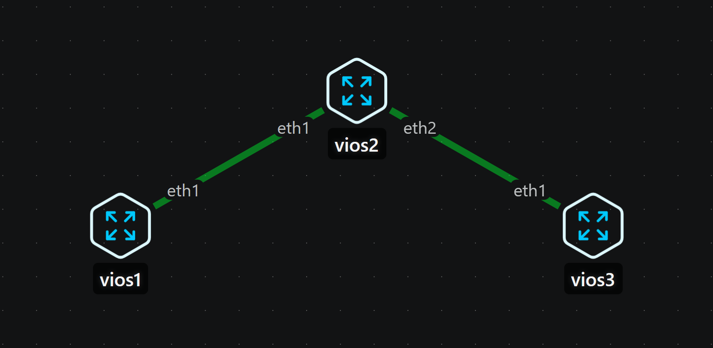

# pyATS Maintenance State Validator

An automated pre-change and post-change network validation tool based on **Cisco pyATS/Genie** and with the helper function (`pyats.async_.pcall`). Designed to replace manual CLI checks during ISP maintenance windows with structured JSON state snapshotting and diffing.

## The Operational Problem
During telecom maintenance windows, Operation and Maintenance Center (OMC) engineers traditionally verify network health by manually running `show`, `LST` (list) or `DSP` (display) commands (depending on the NMS used) before and after a change. This manual comparison is slow, prone to human error, and cluttered by constantly changing uptime timers and packet counters.

## How It Works
1. **Parallel Snapshotting (`pcall`):** Connects concurrently to all routers defined in `testbed.yaml` and uses Genie (`device.learn()`) to parse operational states (OSPF, BGP, Interfaces, Routing) into structured JSON files.
2. **Network-Aware Diffing (`genie.utils.diff`):** Compares pre-change and post-change JSON snapshots while filtering out counters and timers, and only showing/saving real state changes (dropped neighbors, interface state changes, route shifts, etc.).

## Lab Topology
Tested against a 3-router Cisco vIOS topology deployed in **Containerlab** running OSPF Area 0 and iBGP (customers simulated by loopback interfaces):



(Although Containerlab is used to simulate Cisco nodes in this application, the concept of automated pre-change and post-change network validation tools is applicable in Telecom envirenments too)

## Project Structure
```text
pyats-maintenance-validator/
├── README.md
├── requirements.txt
├── validator.py               # Main CLI tool (pre / post / diff)
├── testbed.yaml       # Sanitized device inventory template
├── lab/
│   ├── topology.clab.yml      # 3-router Containerlab definition
│   └── topology_diagram.png   # Network diagram
└── sample_outputs/
    ├── diff_report_sample.txt # Example Genie diff catching an outage/reroute
    ├── pre.json               # Example snapshot of a pre-ops config
    └── post.json              # Example snapshot of a post-ops config
```

## Quickstart & Usage

### 1. Installation
```bash
git clone https://github.com/AymaneBENKARY/pyats-maintenance-validator.git
cd pyats-maintenance-validator
python3 -m venv venv
source venv/bin/activate
pip install -r requirements.txt
```

### 2. Configure Testbed
Copy the example inventory and update it with your lab management IPs and credentials:

### 3. Run Maintenance Validation Workflow
```bash
# Step 1: Capture baseline state before maintenance
python validator.py pre

# Step 2: Perform maintenance change on routers (e.g., interface shutdown or OSPF cost tweak)

# Step 3: Capture post-maintenance state
python validator.py post

# Step 4: Compare states and generate audit report
python validator.py diff
```

## Sample Output
Example output generated when an OSPF/BGP link was shut down between `R1` and `R2` is saved in `sample_outputs/diff_report_sample.txt`

## Tech Stack
* **Automation & Parsing:** Python 3, Cisco pyATS / Genie (`pcall`, `Diff`)
* **Network Emulation:** Containerlab, Cisco vIOS
* **Protocols Tested:** OSPF, iBGP, IPv4 Routing